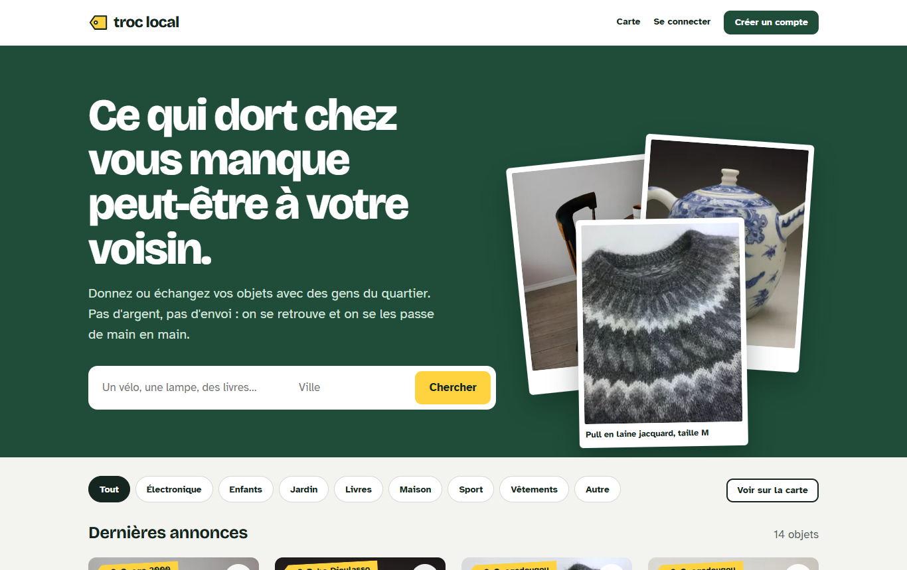
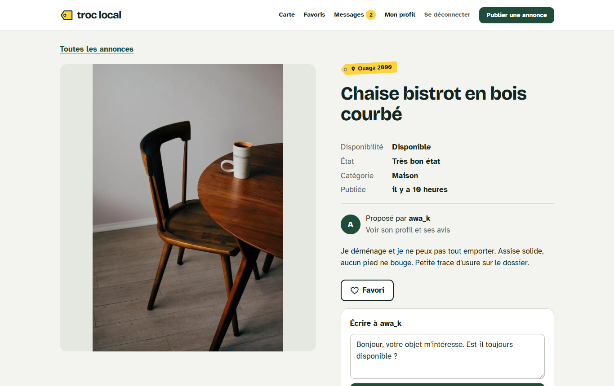
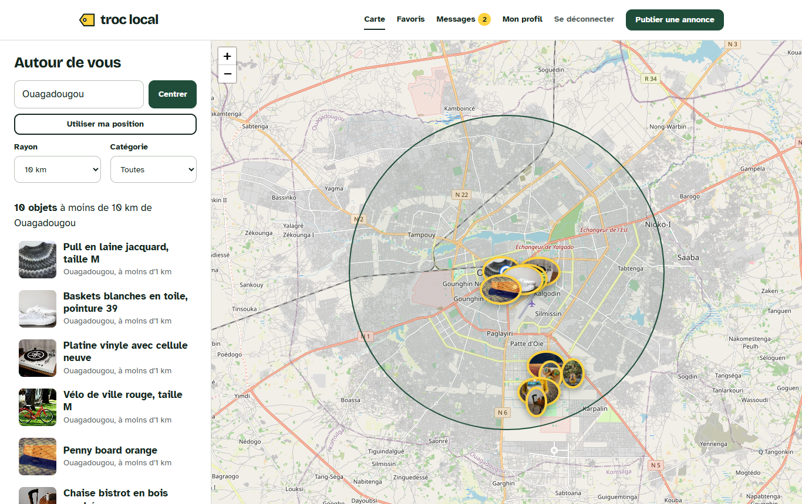
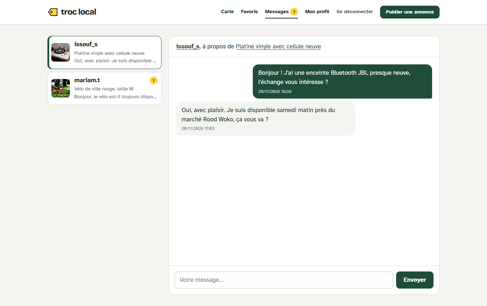
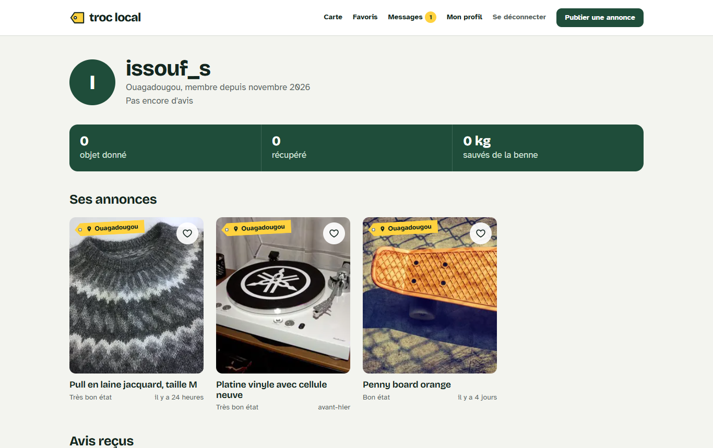
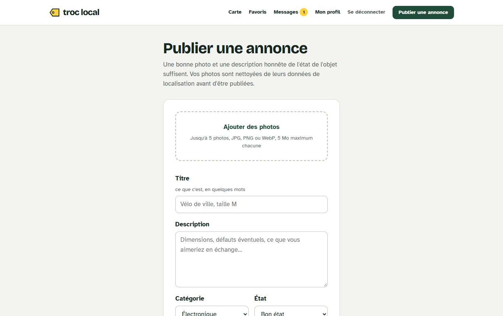
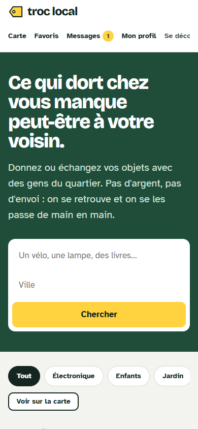

<div align="center">

# ♻️ Troc Local

**Donnez ou échangez les objets dont vous n'avez plus besoin, avec vos voisins.**

Une marketplace locale de don et de troc : annonces avec photos, carte des objets autour de vous, messagerie en temps réel, profils avec avis et un assistant IA propulsé par Claude.


</div>

---

## 📸 Aperçu

<p align="center">
  
</p>

<table>
  <tr>
    <td width="50%"><br><sub><b>Fiche annonce</b> : photos, état, contact direct</sub></td>
    <td width="50%"><br><sub><b>Carte</b> : les objets autour de vous, avec un rayon réglable</sub></td>
  </tr>
  <tr>
    <td><br><sub><b>Messagerie</b> : temps réel, indicateur de saisie, réponses suggérées par l'IA</sub></td>
    <td><br><sub><b>Profil</b> : objets donnés, avis, badges</sub></td>
  </tr>
  <tr>
    <td><br><sub><b>Publication</b> : jusqu'à 5 photos, les données GPS sont retirées</sub></td>
    <td><br><sub><b>Mobile</b> : interface adaptée aux téléphones</sub></td>
  </tr>
</table>

---

## ✨ Fonctionnalités

| | |
|---|---|
| 📦 **Annonces** | Jusqu'à 5 photos, catégorie, état, ville. Statuts : disponible, réservé, donné |
| 🔎 **Recherche** | Plein texte, filtres par catégorie et ville, pagination |
| 🗺️ **Carte** | Objets géolocalisés (OpenStreetMap), rayon de 2 à 100 km ou tout le pays, liste triée par distance |
| 💬 **Messagerie** | Une conversation par objet, temps réel, compteur de non-lus, notifications |
| ⭐ **Avis et profils** | Note après un don, badges (« Premier don », « Très fiable »…), compteur d'impact |
| ❤️ **Favoris** | Retrouvez les objets qui vous plaisent |
| 🤖 **Assistant IA** | Recherche en langage naturel, modération des annonces, réponses suggérées *(facultatif)* |

### 🤖 L'assistant IA

Propulsé par **Claude** via le SDK officiel Anthropic. Il est facultatif : sans clé API, le site fonctionne normalement et les fonctions IA sont masquées.

- **Recherche en langage naturel** : « un vélo pour aller au lycée à Ouaga » devient mots-clés, catégorie et ville.
- **Modération** : chaque nouvelle annonce (texte et photo) est vérifiée. Les objets interdits, les ventes déguisées et les arnaques sont refusés, avec une explication pour l'auteur.
- **Réponses suggérées** : trois réponses courtes dans la messagerie, proposées à la demande et relues avant envoi.

---

## 🧰 Stack

| Couche | Technologies |
|---|---|
| Interface | HTML, CSS, JavaScript (vanilla, Fetch API), Leaflet |
| Serveur | Node.js, Express, express-session, Multer, Socket.IO, sharp, SDK Anthropic |
| Données | MySQL (mysql2, requêtes préparées), sessions stockées en base |
| IA | Claude (`@anthropic-ai/sdk`), sorties JSON structurées |
| Services | Nominatim (localisation des villes), tuiles OpenStreetMap |

<details>
<summary>📐 Modèle de données</summary>

```
users ─┬─< items ─┬─< item_photos
       │          ├─< favorites >─ users
       │          ├─< conversations ─< messages
       │          └─< reviews (reviewer_id / reviewee_id)
       └─────────────────────┘ (buyer_id / seller_id, given_to_id)
categories ─< items           (avg_weight_kg pour le compteur d'impact)
```

</details>

---

## 🚀 Installation

**Prérequis** : Node.js 20 ou plus, MySQL 8.

```bash
git clone https://github.com/Sawadogo-cmk/troc_local.git
cd troc_local
npm install
cp .env.example .env            # renseignez vos identifiants MySQL et SESSION_SECRET
mysql -u root -p < sql/schema.sql
npm run seed                    # facultatif : données de démonstration
npm run dev                     # http://localhost:3000
```

### Variables d'environnement

| Variable | Rôle |
|---|---|
| `PORT` | Port du serveur (3000 par défaut) |
| `DB_HOST`, `DB_USER`, `DB_PASSWORD`, `DB_NAME` | Connexion MySQL |
| `SESSION_SECRET` | Clé de signature des sessions (obligatoire, longue et aléatoire) |
| `GEO_COUNTRY` | Pays de recherche des villes, code ISO à 2 lettres (`bf` : Burkina Faso) |
| `ANTHROPIC_API_KEY` | Active l'assistant IA (facultatif) |
| `AI_MODEL` | Modèle Claude utilisé (`claude-opus-5-5` par défaut) |

### Données de démonstration

`npm run seed` crée 4 comptes à Ouagadougou et Bobo-Dioulasso, 15 annonces illustrées et des conversations. Le script peut être relancé sans risque : il ne touche que les comptes de démo.

| Compte | Mot de passe |
|---|---|
| `demo@exemple.fr` | `demo12345` |
| `awa@exemple.fr`, `issouf@exemple.fr`, `mariam@exemple.fr` | `demo12345` |

Les photos sont dans le domaine public, avec leurs sources dans [seed/CREDITS.md](seed/CREDITS.md).

### Mise à jour depuis une version précédente

```bash
mysql -u root -p troc_local < sql/migration-v2.sql   # coordonnées, avis, poids par catégorie
mysql -u root -p troc_local < sql/migration-v3.sql   # modération des annonces
npm run photos:migrate                                # variantes des anciennes photos
```

---

## 🔐 Sécurité

- **Requêtes préparées** partout, contre l'injection SQL
- **Protection CSRF** : chaque action qui modifie des données exige un jeton de session
- **Limite de tentatives** : 8 échecs de connexion par 15 minutes et par adresse ; 5 créations de compte par heure
- **Sessions en base MySQL**, cookie `Secure` en production, renouvellement à la connexion
- **Content-Security-Policy** stricte : aucun script ni style inline
- **Vie privée** : une annonce est placée au centre de sa commune, jamais à l'adresse exacte ; les métadonnées des photos (dont la position GPS) sont retirées
- **Contrôle d'accès** : seul le propriétaire modifie ou supprime son annonce ; seuls les participants voient une conversation ; un avis ne se laisse qu'une fois, entre le donneur et le receveur
- **IA** : les textes des utilisateurs sont traités comme des données, jamais comme des instructions ; un repli automatique si le modèle décline une requête ; en cas de panne, les annonces sont publiées sans vérification et la recherche classique reste disponible

---

## ✅ Qualité et accessibilité

Points de la [Front-End Checklist](https://github.com/thedaviddias/Front-End-Checklist) appliqués :

- **Head** : `lang`, meta description et Open Graph par page, favicon, `theme-color`
- **HTML sémantique** : `header`, `nav`, `main`, `footer`, lien « Aller au contenu », page 404
- **Images** : `srcset` WebP, dimensions explicites, chargement différé
- **Accessibilité** : focus visible, contrastes AA, onglets accessibles au clavier, notes utilisables au clavier, `aria-live` pour les mises à jour, cibles tactiles de 44 px
- **Performance** : polices avec `preconnect` et `display=swap`, `prefers-reduced-motion` respecté, pas de défilement horizontal sur mobile

Reste à faire : tests automatisés et tests Lighthouse en intégration continue.

---

## 🗺️ Feuille de route

- [x] Messagerie en temps réel (Socket.IO)
- [x] Carte et recherche par rayon
- [x] Profils publics avec avis et badges
- [x] Redimensionnement des images (sharp)
- [x] Protection CSRF et limitation des connexions
- [x] Assistant IA : recherche, modération, réponses suggérées
- [ ] Propositions d'échange (proposer un objet en échange d'un autre)
- [ ] Stockage des images dans le cloud
- [ ] Tests automatisés (Jest + Supertest)
- [ ] Limitation générale des requêtes (`express-rate-limit`)

---

<div align="center">

Projet réalisé avec [Claude Code](https://claude.com/claude-code)

</div>
